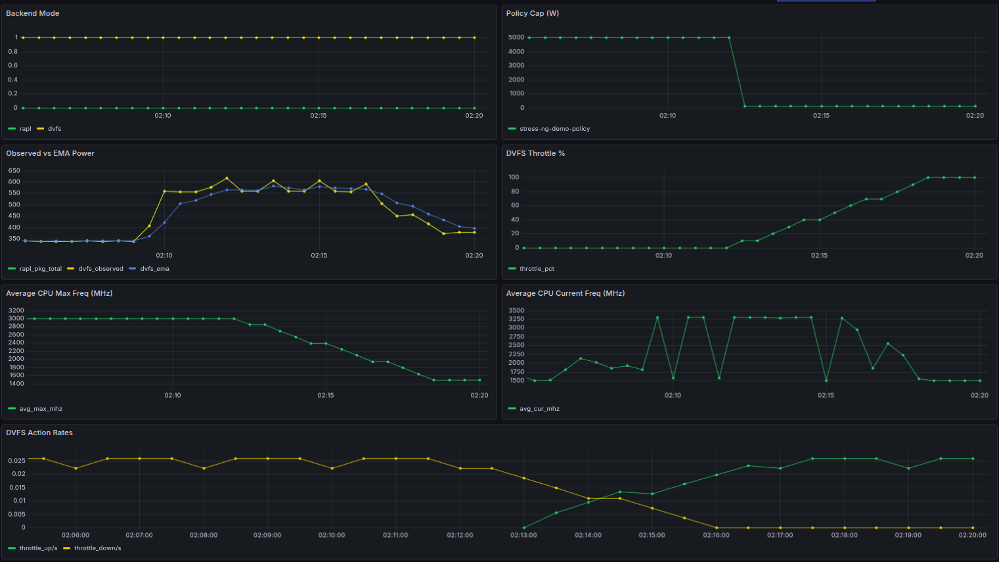

# Example: Prometheus + Grafana observability for Joulie

This example shows how to visualize Joulie behavior, especially when RAPL limits are unavailable and DVFS fallback is active.

It includes:

- `ServiceMonitor` for Prometheus Operator users.
- Grafana dashboard JSON for manual import, focused on DVFS fallback impact (power/EMA/throttle/frequency).
- Prometheus metrics reference: <https://joulie-k8s.github.io/Joulie/docs/architecture/metrics/>

## Prerequisites

- Joulie deployed (for example with `make install TAG=<tag>`).
- Prometheus scraping from `joulie-system/joulie-agent-metrics:8080/metrics`.
- Grafana running.

If you need to install kube-prometheus-stack first, install it into the `monitoring` namespace. The chart's default `PROMETHEUS_ADDRESS`, `http://prometheus-operated.monitoring:9090`, resolves only there:

```bash
helm repo add prometheus-community https://prometheus-community.github.io/helm-charts
helm repo update
helm install telemetry prometheus-community/kube-prometheus-stack \
  -n monitoring --create-namespace -f values/prometheus-grafana.yaml
```

## 1) Verify metrics endpoint

```bash
kubectl -n joulie-system get svc joulie-agent-metrics
kubectl -n joulie-system get endpoints joulie-agent-metrics
```

Quick sample metric check:

```bash
kubectl -n joulie-system port-forward svc/joulie-agent-metrics 18080:8080
curl -s localhost:18080/metrics | grep '^joulie_' | head
```

## Quick access (Prometheus + Grafana UI)

```bash
kubectl -n monitoring port-forward svc/telemetry-kube-prometheus-prometheus 9090:9090 1>/dev/null &
kubectl -n monitoring port-forward svc/telemetry-grafana 5000:80 1>/dev/null &
```

## OTLP inputs for the controller manager

The controller manager reads measured node power and the facility metrics from Prometheus as OpenTelemetry metrics (`hw.energy`, `hw.power`, `joulie.facility.*`). Producers push them to Prometheus' OTLP receiver; the controller manager only runs PromQL. `values/prometheus-grafana.yaml` sets the four Prometheus fields this needs:

| Field | Value | Why |
|---|---|---|
| `prometheusSpec.enableOTLPReceiver` | `true` | serves `POST /api/v1/otlp/v1/metrics`; off by default |
| `prometheusSpec.otlp.promoteResourceAttributes` | `[k8s.node.name, host.name]` | puts the node on every series; without it the controller manager joins `target_info` |
| `prometheusSpec.otlp.translationStrategy` | `UnderscoreEscapingWithSuffixes` | must equal the controller manager's `PROMETHEUS_NAME_TRANSLATION` |
| `prometheusSpec.tsdb.outOfOrderTimeWindow` | `30m` | OTLP samples carry the producer's timestamps |

Point an OTLP exporter at the receiver, for example the simulator in emulate mode or an OpenTelemetry Collector:

```bash
OTEL_EXPORTER_OTLP_METRICS_ENDPOINT=http://telemetry-kube-prometheus-prometheus.monitoring:9090/api/v1/otlp/v1/metrics
```

Check that the series the controller manager reads exist, under the names the default strategy gives them:

```bash
curl -s localhost:9090/api/v1/query --data-urlencode 'query=count by (k8s_node_name, hw_type) (hw_energy_joules_total)'
```

The controller manager counts each query in `joulie_twin_input_queries_total{input,result}`; a `no_data` result usually means the receiver is off or `k8s.node.name` is neither promoted nor on `target_info`. The full input contract is in the [telemetry page](https://joulie-k8s.github.io/Joulie/docs/architecture/telemetry/#input-metrics-opentelemetry).

## 2) Prometheus scrape configuration

### Option A: Prometheus Operator (ServiceMonitor)

```bash
kubectl apply -f examples/02-prometheus-grafana/servicemonitor.yaml
```

The provided manifest is set for a Prometheus installation named `telemetry`:

- `metadata.namespace: default`
- `metadata.labels.release: telemetry`

If your Prometheus release name or operator namespace differs, adjust those fields accordingly.

### Option B: plain Prometheus

Use service annotations from the Helm chart services or add static scrape config.

## 3) Grafana dashboard import

Import this file directly in Grafana:

- [dashboard-joulie-dvfs.json](dashboard-joulie-dvfs.json)
- [dashboard-sample.png](dashboard-sample.png)

Sample dashboard:



## 4) What to look at during the stress-ng demo

- `joulie_backend_mode{mode="dvfs"}` should be `1` when RAPL is not writable.
- `joulie_rapl_package_total_power_watts` and `joulie_dvfs_ema_power_watts` should follow load.
- `joulie_dvfs_throttle_pct` should rise under low cap and drop after high cap is reapplied.
- `joulie_dvfs_cpu_max_freq_khz` should decrease/increase with DVFS actions.

This provides graphical evidence that DVFS fallback still impacts power/frequency behavior when RAPL capping is unavailable.
