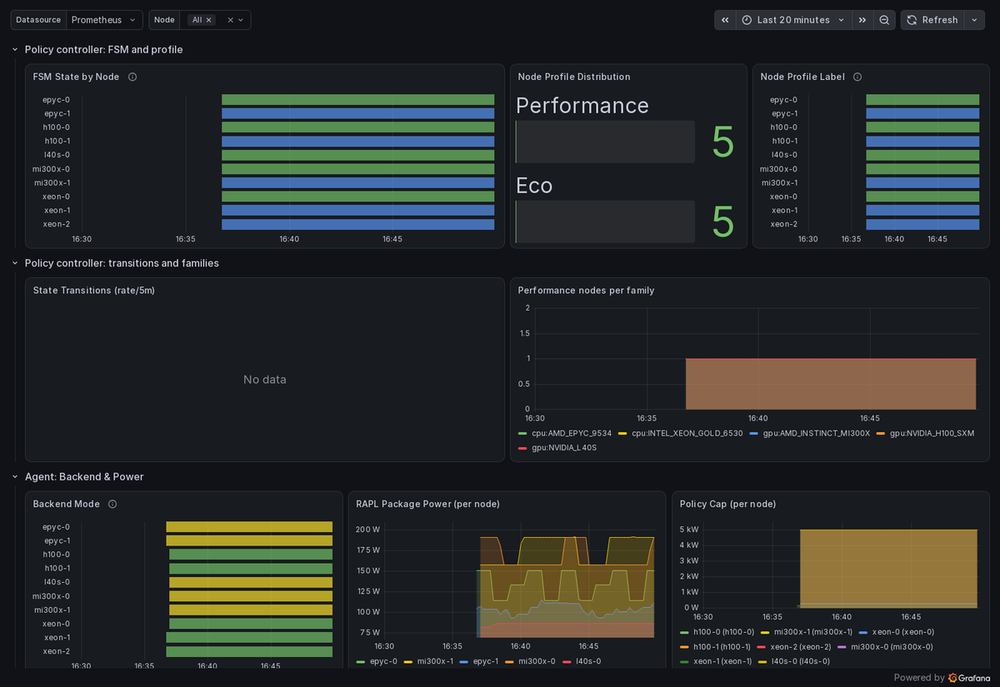

# 03 Grafana dashboard

The Joulie chart ships one Grafana dashboard, `Joulie - Cluster Energy
Overview`: the profile and state of every node, the caps the agents apply and
the power they read, the scheduler extender's requests and scores, and the
facility inputs of the digital twin. This tutorial installs
kube-prometheus-stack, points it at Joulie's metrics and loads the dashboard.
The same steps work on a real cluster.



Needs the cluster of [01 Simulated cluster](../01-simulated-cluster/README.md),
with `KUBECONFIG` set as there, or a cluster with Joulie installed; and `helm`.

## 1. Prometheus and Grafana

```bash
helm repo add prometheus-community https://prometheus-community.github.io/helm-charts
helm upgrade --install telemetry prometheus-community/kube-prometheus-stack --version 92.11.0 \
  -n telemetry --create-namespace -f examples/03-grafana-dashboard/prometheus-values.yaml --wait
```

[`prometheus-values.yaml`](prometheus-values.yaml) lets Prometheus read every
ServiceMonitor, whatever its namespace or labels, and lets the Grafana sidecar
load dashboards from every namespace. If you already run kube-prometheus-stack,
set those values in your release instead. The namespace `telemetry` keeps it
apart from the Prometheus the simulated cluster runs in `monitoring`.

## 2. Scrape Joulie

Each Joulie component serves its metrics on a Service port named `metrics`;
[`servicemonitors.yaml`](servicemonitors.yaml) has one ServiceMonitor per
component. On the simulated cluster, also scrape the simulator, for the
dashboard's two Simulator rows:

```bash
kubectl apply -f examples/03-grafana-dashboard/servicemonitors.yaml
kubectl apply -f examples/03-grafana-dashboard/servicemonitor-simulator.yaml   # simulated cluster only
```

A minute later every target is up:

```bash
kubectl get --raw "/api/v1/namespaces/telemetry/services/telemetry-kube-prometheus-prometheus:9090/proxy/api/v1/targets" |
  jq -r '.data.activeTargets[] | select(.labels.namespace | startswith("joulie")) | "\(.health) \(.labels.job)"' | sort | uniq -c
```

```text
     10 up joulie-agent-metrics
      1 up joulie-controller-manager-metrics
      1 up joulie-scheduler-extender
      1 up joulie-telemetry-sim
```

A Prometheus that discovers targets by annotation needs no ServiceMonitor: the
chart's Services carry `prometheus.io/scrape`, `prometheus.io/port` and
`prometheus.io/path`, which is how the simulated cluster's own Prometheus reads
them.

## 3. The dashboard

`grafanaDashboard.enabled` puts the dashboard in a ConfigMap labelled
`grafana_dashboard: "1"`, which the sidecar loads:

```bash
helm -n joulie-system upgrade joulie charts/joulie --reuse-values --set grafanaDashboard.enabled=true
kubectl -n telemetry port-forward svc/telemetry-grafana 3000:80
```

Open <http://localhost:3000>, log in as `admin` with the password of the values
file, `joulie`, and open **Dashboards, Joulie - Cluster Energy Overview**. With
the chart from a release, use `oci://registry.cern.ch/joulie/joulie` in place
of `charts/joulie`.

What the rows show, top to bottom:

| Row | Panels | Empty when |
|---|---|---|
| Policy controller | each node's state and profile, the transitions, performance nodes per hardware family | no node changed state in the window |
| Agent | the backend (RAPL or DVFS), package power, the cap, DVFS throttling, CPU frequency, reconcile errors, nodes without a reporting agent | no errors: that is good news |
| Agent: Governors | governor presets in effect and their writes | governor control is off, the default ([05](../05-governor-presets/README.md) turns it on) |
| Scheduler Extender | filter and prioritize requests and latency, scores per node and class | no pod was scheduled in the window |
| Twin inputs | facility power, PUE and ambient temperature as the twin reads them, input queries by result | the facility panels, while the facility inputs are off (`ENABLE_FACILITY_METRICS=false`, the chart's default; the simulated cluster turns them on) |
| Simulator (collapsed) | simulated power, utilization, facility and jobs | no simulator; four panels need its HTTP mode, as their descriptions say |

The dashboard's queries are checked by `TestDB01DashboardQueriesSelectExportedMetrics`
in `tests/promql`: a metric renamed in the code without the dashboard fails CI.

## Clean up

```bash
helm -n joulie-system upgrade joulie charts/joulie --reuse-values --set grafanaDashboard.enabled=false
kubectl delete -f examples/03-grafana-dashboard/servicemonitor-simulator.yaml -f examples/03-grafana-dashboard/servicemonitors.yaml
helm -n telemetry uninstall telemetry
```
