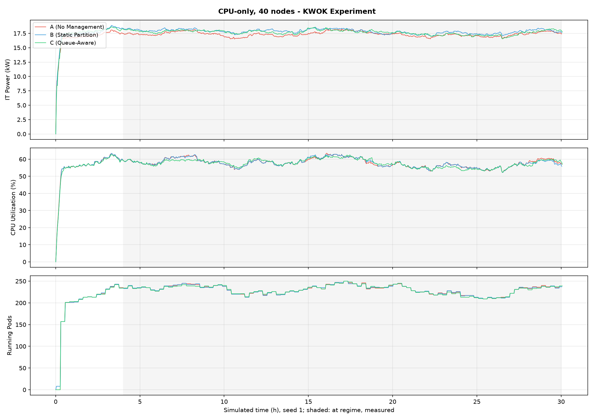
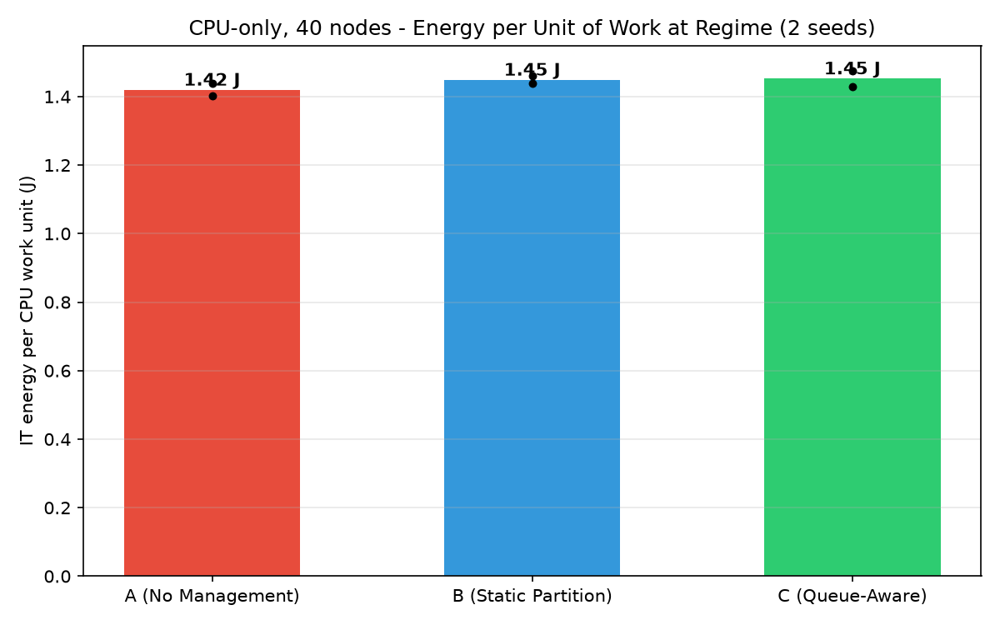
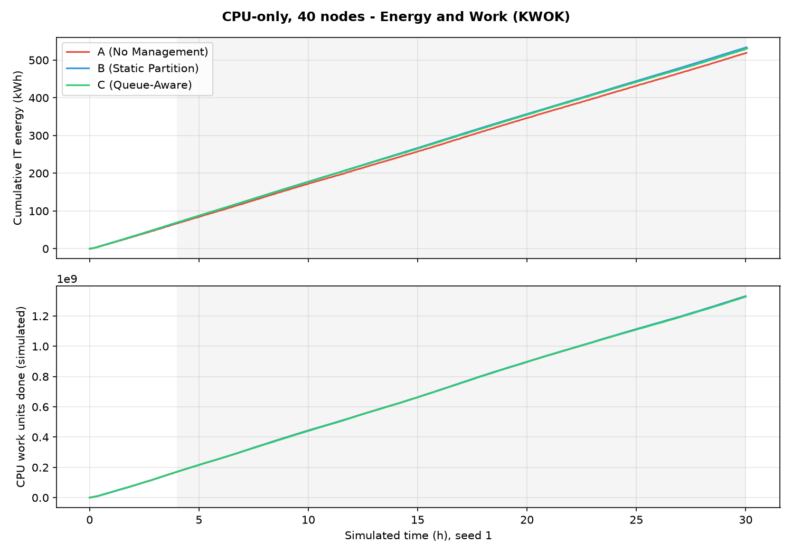
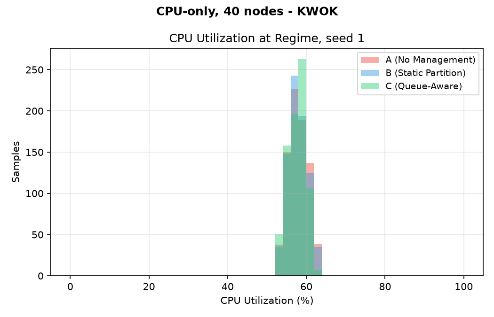
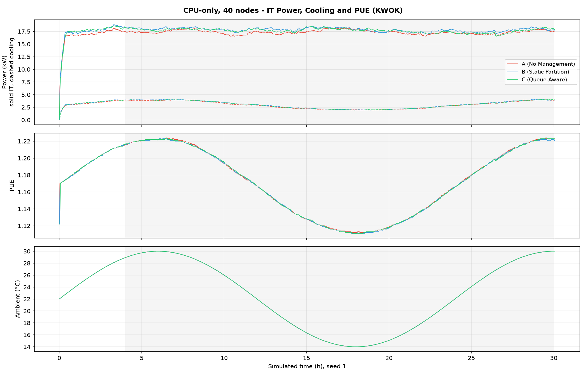
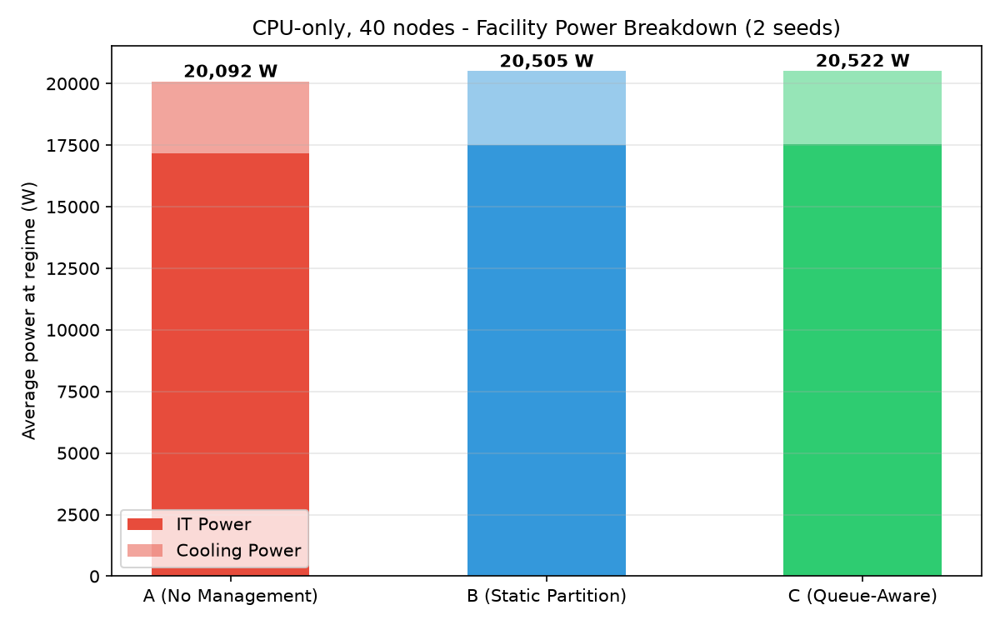

# CPU-Only Benchmark Report (KWOK, 40 Nodes)

These results come from the Joulie simulator, Joulie's test bed for its behaviour (caps applied, placement, policies), not evidence of energy savings. Their energy figures rest on hardware behaviour the simulator assumes: every CPU core does the same work per second whatever its model, and cap responses, power curves and workload intensities are assumed or fitted, not measured on real nodes. They do not show what Joulie saves on real hardware; what meaningful experiments need is tracked in the milestone [Evidence-based evaluation](https://github.com/joulie-k8s/Joulie/milestone/1).

This report compares three baselines on a cluster of CPU-only nodes, at regime: after the ramp-up and before the drain. The runs are of 2026-10-28, with the Joulie and simulator images `joulie.local/*:rerun-2026-10-28` built from this tree ([`experiments/README.md`](../README.md), "Images").

- `A`: the simulator only, no power management.
- `B`: Joulie with the static partition policy.
- `C`: Joulie with the queue-aware policy.

In short:
- B and C used 1.4 to 2.7 % more energy per unit of work than A, while doing the same work.
- The sign held in all four pairs (two policies, two seeds). A's repeat differed by 0.24 %. B's and C's own noise was not measured ([#113](https://github.com/joulie-k8s/Joulie/issues/113)).
- An accounting split by node family puts most of the difference on the EPYC 9375F family. Under B and C it does more of the work, and its dynamic energy per unit rises as that work turns compute-bound.
- The eco caps bind in about a third of the eco 9655 nodes' control calls, up to a sixth on the 9375F and almost never on the 9965.

The split does not separate what the caps do from what the placement does: that needs a run with the caps off ([#113](https://github.com/joulie-k8s/Joulie/issues/113)). Both effects rest on simulator assumptions, notably that every core does the same work per second (section 7, [#107](https://github.com/joulie-k8s/Joulie/issues/107)). So this experiment does not show what B and C would do on real hardware.

## 1. Experimental Setup

### 1.1 Cluster and nodes

A [kind](https://kind.sigs.k8s.io/) cluster (control plane and one worker) runs the real Kubernetes control plane and the Joulie components; 40 [KWOK](https://kwok.sigs.k8s.io/) nodes stand for the managed hardware, and the Joulie simulator models their power and runs the workload's pods.

### 1.2 Node inventory

| Nodes | Count | CPU | Cores |
|---|---:|---|---:|
| `kwok-cpu-highcore` | 10 | 2 x AMD EPYC 9965 | 384 |
| `kwok-cpu-highfreq` | 10 | 2 x AMD EPYC 9375F | 64 |
| `kwok-cpu-intensive` | 20 | 2 x AMD EPYC 9655 | 192 |

8,320 cores in all, no GPUs (`configs/cluster-nodes.yaml`).

### 1.3 Hardware models in the simulator

As resolved by the simulator in these runs (`sim_debug_nodes.json`):

| CPU | Model | Power at 0 % and 100 % load |
|---|---|---|
| EPYC 9655 | SPECpower curve, result 01457 | 126 W, 751 W |
| EPYC 9965 | SPECpower curve, result 01522 | 157 W, 800 W |
| EPYC 9375F | analytic model, no published curve | 80 W, 640 W (sockets x TDP) |

- **Frequency:** a cap lowers a node's frequency scale `f`. Power at `f` is the power at full frequency, with its dynamic part scaled by `f^1.43`, on both models. `SIM_BETA_FREQ` 1.43 is fitted to published frequency and power caps on servers (`TestBetaFreqFit`, [wiki: CPU power model](https://github.com/joulie-k8s/Joulie/wiki/CPU-Power-Model)).
- **Throughput:** each job's throughput at `f` follows its work class (`ThroughputMultiplier`).
- **Speed:** every core does the same work per second, `base_speed_per_core` 2.0, whatever its CPU.

### 1.4 Run configuration

| Parameter | Value |
|---|---|
| Seeds | 2, plus a repeat of the first run (A, seed 1) |
| Time scale | 120 (one wall second is two simulated minutes) |
| Measured window | 120 to 900 wall seconds, 26 simulated hours, after a prefill of the backlog |
| Workload | `cpu_preprocess` and `cpu_analytics` jobs, 20 % performance jobs, work scale 0.2627 |
| Load under A | CPU utilization 0.553 and 0.579, sized for 0.55 ([`experiments/README.md`](../README.md), "Sizing the load") |

### 1.5 Caps

The agent turns a percent cap into watts against each node's catalog range, sockets x 0.55 x TDP to sockets x TDP.
- **Performance nodes:** 100 %, the TDP, which the curves never reach.
- **Eco nodes:** 60 %, which is 480 W on a 9655 node, 600 W on a 9965 and 384 W on a 9375F.

Per socket these eco caps (240, 300 and 192 W) are below each CPU's cTDP minimum (320, 450 and 320 W in the catalog). AMD's tuning guide 58002 allows a package power limit below the TDP minimum; no published measurement found covers throughput there.

### 1.6 Policy sizing

The policies are sized on seeds 3 and 4, which the sweep does not measure ([`experiments/README.md`](../README.md)).
- **B:** keeps 19 of the 40 nodes as performance nodes (`hp_frac` 0.48).
- **C:** starts from 15 (`hp_base_frac` 0.375) and adds one per 6 performance pods, up to every node.

Both split the performance nodes over the three families in proportion to their nodes (`PerformanceSet`). Under A the jobs carry no performance affinity.

## 2. Policy Algorithms

### 2.1 Static partition (`static_partition`)

A fixed set of 19 performance nodes; every other node is eco and gets the eco cap. Performance jobs may run only on performance nodes.

### 2.2 Queue-aware (`queue_aware_v1`)

The performance set follows the demand: the base count plus one node per 6 performance pods, running or pending, recomputed every 300 simulated seconds.

### 2.3 Scheduler

kube-scheduler with the Joulie scheduler extender at weight 1 under B and C. A performance job carries a required node affinity that excludes eco nodes (`joulie.io/power-profile NotIn [eco]`); under A that affinity is stripped.

## 3. Simulator Realism

### 3.1 Workload

The trace comes from `simulator/cmd/workloadgen` (schema v2): Poisson arrivals at a rate that follows a 24-hour pattern in simulated time, with a burst hour on half of the days and a dip hour on 40 % of them. A compute-bound workload is 3.5 times as likely to be a performance job as another (`compute_bound_perf_boost`): on seed 1, 89 % of the performance jobs' work is compute-bound, against 45 % of the others'.

### 3.2 Facility

The outside air follows a sinusoid of 22 ± 8 °C with a period of 24 simulated hours. The PUE is an assumed analytic function of that temperature and of the IT load (`simulator/pkg/facility`), not fitted to a facility; cooling power is IT power x (PUE - 1).

## 4. Measured Results

From `experiments/kwok-cluster/report_figures.py` over the runs of 2026-10-28; every run's simulator reports `BetaFreq` 1.43.

### 4.1 Per run

| Baseline | Seed | Avg IT power (W) | CPU work (units, simulated) | J per unit | CPU util (%) | Performance nodes | Pending performance jobs | Host load mean (28 CPUs) |
|---|---:|---:|---:|---:|---:|---:|---:|---:|
| A | 1 | 17,365 | 1,160,119,578 | 1.401 | 57.9 | none | 0.4 | 16.6 |
| A | 2 | 16,958 | 1,103,108,126 | 1.439 | 55.3 | none | 0.3 | 20.7 |
| B | 1 | 17,831 | 1,160,147,380 | 1.439 | 57.8 | 19.0 | 0.4 | 19.9 |
| B | 2 | 17,201 | 1,103,106,950 | 1.459 | 55.3 | 19.0 | 0.3 | 18.4 |
| C | 1 | 17,678 | 1,157,137,935 | 1.430 | 57.7 | 16.6 | 1.3 | 16.4 |
| C | 2 | 17,381 | 1,102,584,876 | 1.475 | 55.3 | 16.2 | 0.7 | 20.7 |

Every run passed every gate ([`experiments/README.md`](../README.md)).

### 4.2 Change against A, paired by seed

| Baseline | Avg IT power (%) | CPU work done (%) | Energy per CPU unit (%) | Backlog at end (%) |
|---|---:|---:|---:|---:|
| B | +2.7 / +1.4 | +0.0 / -0.0 | +2.7 / +1.4 | +0.1 / -0.0 |
| C | +1.8 / +2.5 | -0.3 / -0.0 | +2.1 / +2.5 | +0.8 / +0.3 |

### 4.3 Run-to-run noise

A's repeat on seed 1 (load 17.3 against 16.6) differed by -0.30 % in IT power, -0.06 % in work and -0.24 % in energy per unit. B and C were not repeated, so their own noise is unknown ([#113](https://github.com/joulie-k8s/Joulie/issues/113)); what stands is the sign, positive in all four of their changes against A.

### 4.4 Where the energy went

`experiments/kwok-cluster/decompose_energy.py` splits the change in energy per unit by node family. It is accounting, not cause.
- **Time base:** the whole run, 0 to 900 s, since each family's work is known only at the end, so the totals differ slightly from 4.2.
- **Idle and dynamic energy:** each family's energy splits into idle energy (its nodes' model idle power times the time) and dynamic energy.
- **Terms:** the change is the sum of an idle term, a placement term (work moving between families, at A's dynamic energy per unit in each) and each family's own term (its dynamic energy per unit changing).

| | Seed 1 B | Seed 1 C | Seed 2 B | Seed 2 C |
|---|---:|---:|---:|---:|
| Change in J per unit | +2.84 % | +2.41 % | +1.43 % | +2.57 % |
| Idle | +0.01 pp | +0.07 pp | -0.00 pp | -0.01 pp |
| Placement | +0.81 pp | +0.92 pp | +0.32 pp | +1.99 pp |
| 9375F own | +2.85 pp | +2.40 pp | +1.84 pp | +1.87 pp |
| 9655 own | -0.42 pp | -0.71 pp | -0.19 pp | -1.06 pp |
| 9965 own | -0.40 pp | -0.26 pp | -0.55 pp | -0.23 pp |
| 9375F share of the work (A: 0.064, 0.065) | 0.078 | 0.073 | 0.072 | 0.076 |
| 9375F work that is compute-bound (A: 0.15, 0.25) | 0.46 | 0.43 | 0.46 | 0.44 |

- **The 9375F family.** Under A a unit of work costs 1.67 to 1.74 J of dynamic energy on a 9375F, against 0.60 to 0.61 on a 9965 and 1.37 to 1.38 on a 9655 (idle power is each CPU's curve at 0 % load, or the generic model's for the 9375F). Under B and C the 9375F family does more of the work, and its own dynamic energy per unit rises with it. Its work turns compute-bound: performance jobs are mostly compute-bound (89 % of their work on seed 1, against 45 % of the others'), and B and C send them to performance nodes, which include half of the 9375F nodes. Its analytic model draws more power for compute-bound work, through an activity factor with assumed coefficients.
- **The caps.** In the agent's control calls at the eco cap, the node drew at least 97 % of its cap in 31 to 36 % of the calls on the 9655 (303 to 346 of 957 to 971), 0 to 16 % on the 9375F and almost never on the 9965. The 9655's own term is negative in all four cells, but the split cannot tell a cap's effect from a change in the jobs it ran.

## 5. Plot Commentary

Plots are in [`img/kwok/`](./img/kwok/).

### 5.1 Power timeseries



On seed 1, B and C draw slightly more power than A over most of the window, at the same CPU utilization and with the same running pods.

### 5.2 Energy comparison



### 5.3 Cumulative energy and work



### 5.4 Utilization



### 5.5 PUE



### 5.6 Facility power



## 6. Interpretation

At this load and with these models, B and C cost energy instead of saving it: 1.4 to 2.7 % per unit of work, for the same work.

**Where the energy went.** Most of the difference sits on the 9375F family, which the policies give more work, and more compute-bound work. The simulator gives every core the same speed, so the 9375F's high clock buys nothing while its power per core is several times the others'. Per-device speed is tracked in [#107](https://github.com/joulie-k8s/Joulie/issues/107).

**The caps.** They bind in about a third of the eco 9655 nodes' control intervals, and the 9655's own term is small. Whether the caps or the placement drive each term would take a run of B and C with the eco caps off ([#113](https://github.com/joulie-k8s/Joulie/issues/113)).

**The frequency exponent.** `SIM_BETA_FREQ` acts only where a cap binds. No sweep at the ends of its published band (0.86 to 2.45) was run, so how far 01's result moves across the band is not measured. Every value in that band gives each workload type a mean throughput loss smaller than its power loss under a cap, so that saving is an input of the model, not a finding here.

## 7. Limitations

- **Equal speed per core.** The simulator gives every core the same speed. A 9375F core at 3.8 to 4.8 GHz does more work per second than a 9965 core at 2.25 to 3.7 GHz, so the cost of placing work on the 9375F is overstated here ([#107](https://github.com/joulie-k8s/Joulie/issues/107)).
- **Activity factor.** The analytic model's activity factor (memory and IO intensity lower power) has assumed coefficients, and it sets the 9375F's own term.
- **The frequency exponent.** It is fitted to measurements of older CPUs (Zen 2, Cascade Lake), none of the modelled ones.
- **Whole-server power.** The caps bind on the curve's whole-server power, where a real package limit leaves out the rest of the server, so they bind earlier than on hardware.
- **Caps below cTDP minimum.** The eco caps are below each CPU's cTDP minimum (section 1.5).
- **Noise.** There are two seeds and one repeat, of A only. Repeats for every arm are tracked in [#113](https://github.com/joulie-k8s/Joulie/issues/113).
- **Shared host.** Each run's load is listed. The mean load ranged from 16.4 to 20.7, under the gate of 28.

## Reproduce

Build and load the images as [`experiments/README.md`](../README.md) ("Images") shows, run `scripts/20_run_benchmark.sh configs/benchmark-40n.yaml`, then:

```bash
python experiments/kwok-cluster/report_figures.py RESULTS_DIR experiments/01-cpu-only-benchmark/img/kwok "CPU-only, 40 nodes" experiments/01-cpu-only-benchmark/configs/benchmark-40n.yaml
python experiments/kwok-cluster/decompose_energy.py RESULTS_DIR
```
