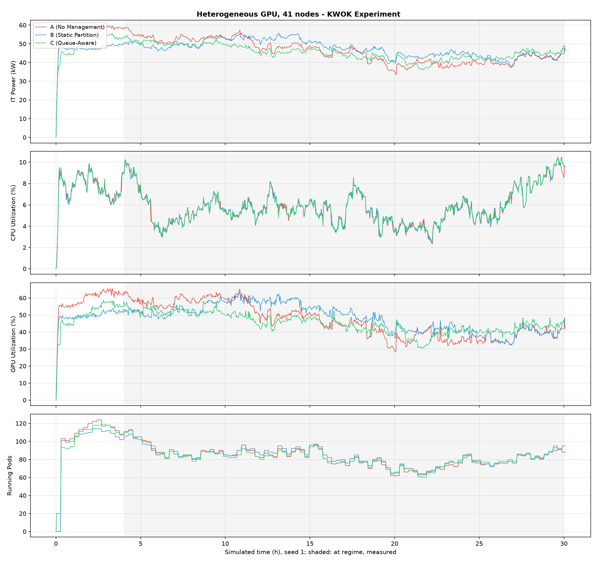
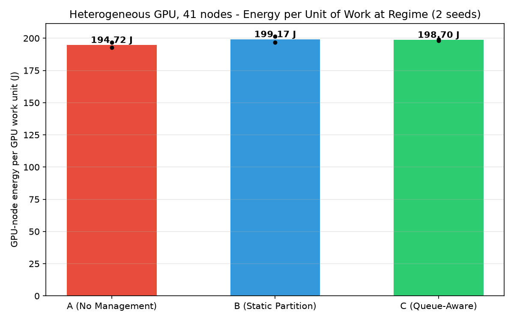
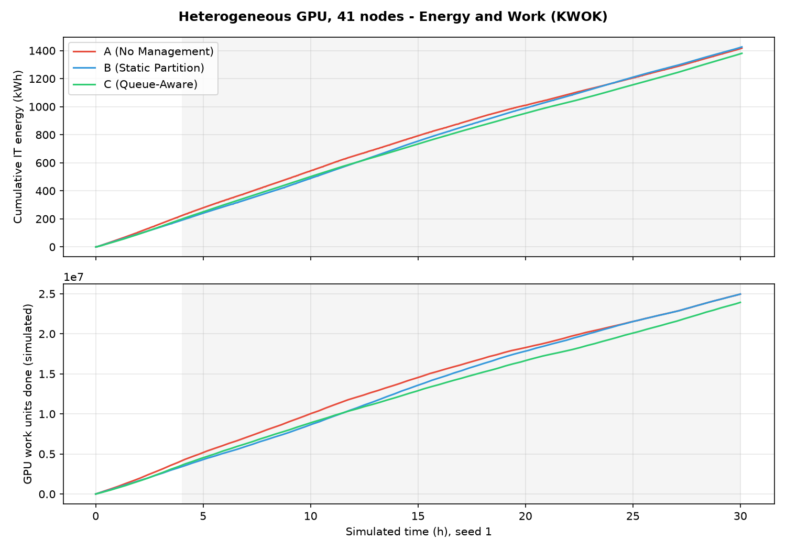
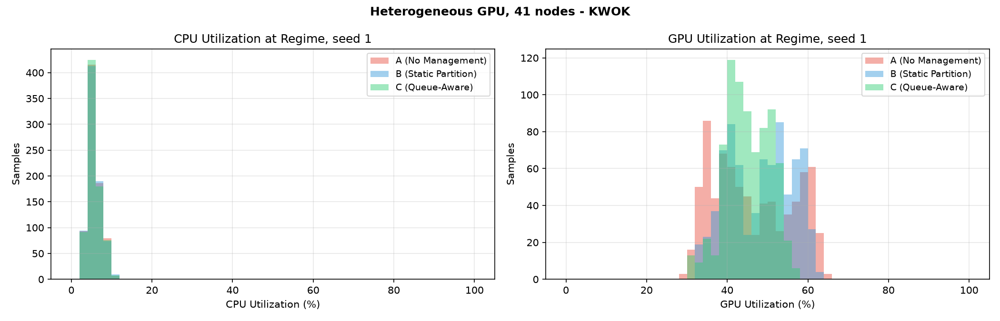
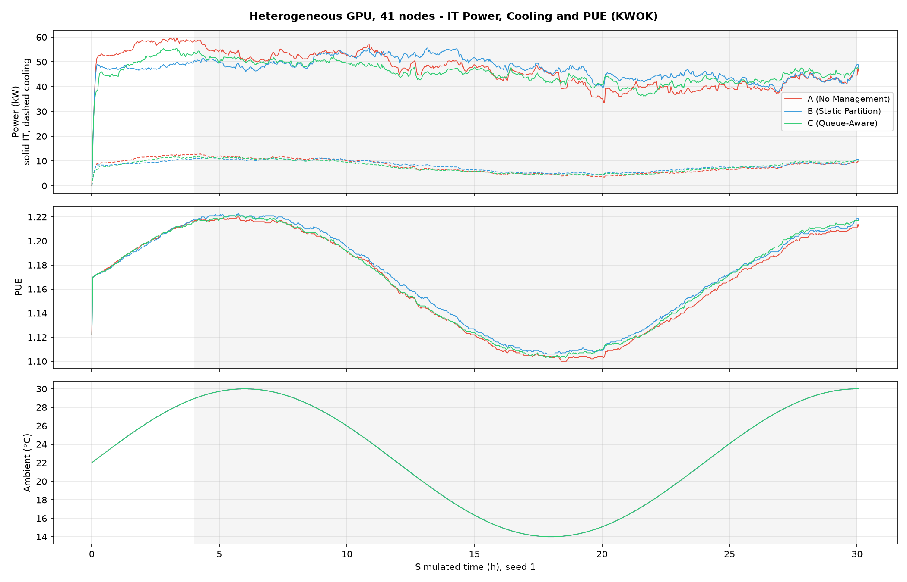
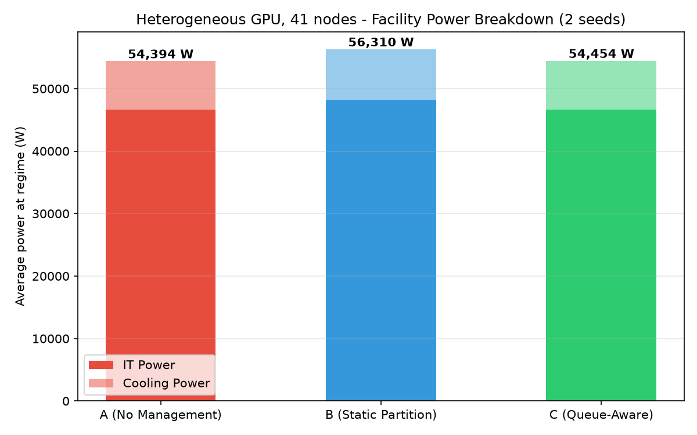

# Heterogeneous GPU Cluster Benchmark Report (KWOK, 41 Nodes)

These results come from the Joulie simulator, Joulie's test bed for its behaviour (caps applied, placement, policies), not evidence of energy savings. Their energy figures rest on hardware behaviour the simulator assumes: every CPU core and every GPU does the same work per second whatever its model, and cap responses, power curves and workload intensities are assumed or fitted, not measured on real nodes. They do not show what Joulie saves on real hardware; what meaningful experiments need is tracked in the milestone [Evidence-based evaluation](https://github.com/joulie-k8s/Joulie/milestone/1).

This report compares three baselines on a cluster of five GPU families and three CPU-only families, at regime: after the ramp-up and before the drain. The runs are of 2026-10-28, with the Joulie and simulator images `joulie.local/*:rerun-2026-10-28` built from this tree ([`experiments/README.md`](../README.md), "Images").

- `A`: the simulator only, no power management.
- `B`: Joulie with the static partition policy.
- `C`: Joulie with the queue-aware policy.

In short:
- B and C used 0.1 to 4.6 % more GPU-node energy per unit of GPU work than A.
- They kept 3.5 and 5.8 performance jobs waiting on average, where A had 0.7.
- The sign held in all four pairs. A's repeat differed by 0.56 %. B's and C's own noise was not measured; repeats for every arm are tracked in [#113](https://github.com/joulie-k8s/Joulie/issues/113).

An accounting split by GPU family puts the difference on placement. Under B and C more of the GPU work runs on the MI300X and the H100 NVL, which cost more per unit in the simulator. Against that, the H100 NVL's own dynamic energy per unit falls by 1.7 to 2.8 points.

The split does not separate the caps from the placement: that needs a run with the caps off, which was not made ([#113](https://github.com/joulie-k8s/Joulie/issues/113)). The per-family costs differ because the simulator gives every GPU the same speed, whatever its power (section 7, [#107](https://github.com/joulie-k8s/Joulie/issues/107)).

## 1. Experimental Setup

### 1.1 Cluster and nodes

A [kind](https://kind.sigs.k8s.io/) cluster (control plane and one worker) runs the real Kubernetes control plane and the Joulie components; 41 [KWOK](https://kwok.sigs.k8s.io/) nodes stand for the managed hardware, and the Joulie simulator models their power and runs the workload's pods.

### 1.2 Node inventory

| Nodes | Count | GPUs per node | CPU | GPU cap range (W per GPU) |
|---|---:|---|---|---|
| `kwok-h100-nvl` | 12 | 8 x NVIDIA H100 NVL | 2 x AMD EPYC 9654 | 200 to 400 |
| `kwok-h100-sxm` | 6 | 4 x NVIDIA H100 80GB HBM3 | 2 x Intel Xeon Gold 6530 | 300 to 700 |
| `kwok-l40s` | 7 | 4 x NVIDIA L40S | 2 x AMD EPYC 9534 | 200 to 350 |
| `kwok-mi300x` | 2 | 8 x AMD Instinct MI300X | 2 x AMD EPYC 9534 | 400 to 750 |
| `kwok-w7900` | 6 | 4 x AMD Radeon PRO W7900 | 2 x AMD EPYC 9534 | 200 to 295 |
| `kwok-cpu-highcore`, `-highfreq`, `-intensive` | 2, 2, 4 | none | EPYC 9965, 9375F, 9655 | |

188 GPUs (148 NVIDIA, 40 AMD) on 33 GPU nodes, and 8 CPU-only nodes (`configs/cluster-nodes.yaml`).

### 1.3 Hardware models in the simulator

Each GPU family's node class is generated from `scripts/generate_heterogeneous_assets.py`, and every run checks that the simulator took it (`class_failures`, `04_run_one.py`).

| GPU | Idle W per GPU | computeGamma | memoryEpsilon |
|---|---:|---:|---:|
| H100 NVL | 58.6 | 0.50 | 0.01 |
| H100 80GB HBM3 (SXM) | 69.6 | 0.43 | 0.01 |
| L40S | 36.3 | 1.20 | 0.01 |
| MI300X | 120 | 0.62 | 0.20 |
| W7900 | 10.8 | 1.00 | 0.20 |

- **Cap response.** Under a cap, a compute-bound job's throughput is `(cap / natural power)^computeGamma`. The exponents are fitted to published throughput at several power limits, MLPerf MaxQ against MaxP runs and papers ([wiki: GPU power model](https://github.com/joulie-k8s/Joulie/wiki/GPU-Power-Model#per-family-parameters)).
  - The H100 NVL has no published data and takes the H100 PCIe's value.
  - The W7900 has none for any RDNA3 GPU and keeps the default 1.0.
- **Idle power.** The idle powers are measured on real nodes, except the MI300X's, which is assumed.
- **Speed.** Every GPU does the same GPU work per second, `GPURequest x BaseSpeed` (`simulator/pkg/workload/rates.go`), whatever its family.
- **CPUs.** The CPUs run as in experiment 01 (`SIM_BETA_FREQ` 1.43).

### 1.4 Run configuration

| Parameter | Value |
|---|---|
| Seeds | 2, plus a repeat of the first run (A, seed 1) |
| Time scale | 120 (one wall second is two simulated minutes) |
| Measured window | 120 to 900 wall seconds, 26 simulated hours, after a prefill of the backlog |
| Workload | 75 % GPU jobs, 25 % performance jobs, work scale 0.0401 |
| Load under A | GPU utilization 0.463 and 0.494; the scale came down to 0.0401 by the README's rule after a pilot at 0.0444 kept jobs queued ([`experiments/README.md`](../README.md), "Sizing the load") |

A GPU job goes to the vendor pool (NVIDIA or AMD) whose GPUs are the least requested when it is submitted, and kube-scheduler bin-packs GPUs within a pool.

### 1.5 Caps

- **GPUs.** Eco GPUs are capped at 70 % of their maximum: 280 W on an H100 NVL, 490 on an SXM, 245 on an L40S, 525 on an MI300X and 206.5 on a W7900. Each is above its family's minimum.
- **CPUs.** Eco GPU nodes keep their CPUs uncapped. The CPU-only nodes are capped at 60 % of sockets x TDP, as in experiment 01.

### 1.6 Policy sizing

The policies are sized on seeds 3 and 4, which the sweep does not measure.
- **B:** keeps 31 of the 41 nodes as performance nodes (`hp_frac` 0.76).
- **C:** starts from 14 (`hp_base_frac` 0.34) and adds one per 3 performance pods, running or pending.

Both split the performance nodes over the families in proportion to their nodes (`PerformanceSet`).

## 2. Policy Algorithms

- **Static partition (`static_partition`).** A fixed set of performance nodes; every other node is eco and gets the eco caps. Performance jobs may run only on performance nodes.
- **Queue-aware (`queue_aware_v1`).** The performance set follows the demand, recomputed every 300 simulated seconds.
- **Scheduler.** kube-scheduler with the Joulie scheduler extender at weight 1 under B and C. A performance job carries a required node affinity that excludes eco nodes (`joulie.io/power-profile NotIn [eco]`); under A that affinity is stripped.

## 3. Simulator Realism

- **Workload.** The trace comes from `simulator/cmd/workloadgen` (schema v2): Poisson arrivals at a rate that follows a 24-hour pattern in simulated time, with a burst hour on half of the days and a dip hour on 40 % of them. A GPU job asks for 1, 2, 4 or 8 GPUs (80, 10, 7 and 3 %), and its GPU utilization is the generator's raised by 45 % (at most 1).
- **Facility.** The outside air follows a sinusoid of 22 ± 8 °C with a period of 24 simulated hours. The PUE is an assumed analytic function of that temperature and of the IT load (`simulator/pkg/facility`); cooling power is IT power x (PUE - 1).

## 4. Measured Results

From `experiments/kwok-cluster/report_figures.py` over the runs of 2026-10-28; every run's simulator reports `BetaFreq` 1.43, and every run passed every gate.

### 4.1 Per run

| Baseline | Seed | Avg IT power (W) | GPU work (units, simulated) | GPU-node J per GPU unit | GPU util (%) | Performance nodes | Pending performance jobs | Pending 8-GPU jobs | Host load mean (28 CPUs) |
|---|---:|---:|---:|---:|---:|---:|---:|---:|---:|
| A | 1 | 45,789 | 20,807,983 | 196.7 | 46.3 | none | 0.6 | 0.6 | 4.0 |
| A | 2 | 47,497 | 22,013,917 | 192.7 | 49.4 | none | 0.8 | 0.1 | 4.3 |
| B | 1 | 47,430 | 21,550,472 | 196.9 | 48.2 | 31.0 | 3.1 | 2.9 | 13.7 |
| B | 2 | 48,943 | 21,700,157 | 201.5 | 48.8 | 31.0 | 4.0 | 4.3 | 6.3 |
| C | 1 | 45,319 | 20,331,429 | 199.1 | 45.1 | 23.5 | 5.8 | 4.9 | 7.6 |
| C | 2 | 47,894 | 21,543,594 | 198.3 | 48.3 | 25.9 | 5.8 | 4.8 | 6.0 |

### 4.2 Change against A, paired by seed

| Baseline | Avg IT power (%) | GPU work done (%) | GPU-node energy per GPU unit (%) | CPU-only-node energy per CPU-only unit (%) | Backlog at end (%) |
|---|---:|---:|---:|---:|---:|
| B | +3.6 / +3.0 | +3.6 / -1.4 | +0.1 / +4.6 | +2.4 / +2.6 | -0.2 / +24.8 |
| C | -1.0 / +0.8 | -2.3 / -2.1 | +1.2 / +2.9 | +0.5 / +3.9 | +29.1 / +23.8 |

### 4.3 Run-to-run noise

A's repeat on seed 1 (load 6.0 against 4.0) differed by +0.61 % in IT power, +0.09 % in GPU work and +0.56 % in GPU-node energy per GPU unit. B and C were not repeated, so their own noise is unknown ([#113](https://github.com/joulie-k8s/Joulie/issues/113)); what stands is the sign, positive in all four of their changes in energy per unit against A, though B's +0.1 % on seed 1 is within A's repeat.

### 4.4 Where the energy went

`experiments/kwok-cluster/decompose_energy.py` splits the change in GPU-node energy per GPU unit by GPU family. It is accounting, not cause.
- **Time base:** the whole run, 0 to 900 s, since each family's work is known only at the end, so the totals differ from 4.2.
- **Idle and dynamic energy:** each family's energy splits into idle energy (its nodes' model idle power times the time) and dynamic energy.
- **Terms:** the change is the sum of an idle term (idle energy spread over a different amount of work), a placement term (work moving between families, at A's dynamic energy per unit in each) and each family's own term.

Under A a unit of GPU work costs, in dynamic energy, 99 to 100 J on a W7900, 106 to 107 on an L40S, 126 to 129 on an H100 NVL, 202 to 212 on an H100 SXM and 215 to 223 on an MI300X (idle power counts the GPUs' idle and each CPU's curve at 0 % load, or the generic model's).

| | Seed 1 B | Seed 1 C | Seed 2 B | Seed 2 C |
|---|---:|---:|---:|---:|
| Change in J per GPU unit | +0.60 % | +1.46 % | +4.25 % | +2.56 % |
| Idle | -0.01 pp | +1.31 pp | +1.21 pp | +1.16 pp |
| Placement | +2.30 pp | +2.47 pp | +4.60 pp | +3.24 pp |
| H100 NVL own | -1.83 pp | -2.19 pp | -2.82 pp | -1.68 pp |
| H100 SXM own | -0.10 pp | -0.06 pp | +0.98 pp | +0.29 pp |
| L40S own | +0.22 pp | +0.23 pp | +0.30 pp | -0.03 pp |
| MI300X own | +0.06 pp | -0.34 pp | +0.09 pp | -0.41 pp |
| W7900 own | -0.04 pp | +0.05 pp | -0.13 pp | -0.01 pp |
| MI300X share of GPU work (A: 0.067, 0.063) | 0.114 | 0.100 | 0.124 | 0.098 |
| H100 NVL share of GPU work (A: 0.457, 0.467) | 0.578 | 0.566 | 0.554 | 0.544 |

- **Placement.** The policies move GPU work onto the MI300X and the H100 NVL, away from the L40S and the W7900. The path from the policies to these shares was not traced: performance jobs may run only on performance nodes, and the vendor pool follows the pools' requested load.
- **The H100 NVL.** Its own dynamic energy per unit falls, as a cap with an exponent of 0.50 lets it do; the split cannot tell that from a change in the jobs it ran.
- **The MI300X.** Its own term is about zero. At the end of the runs both MI300X nodes were uncapped under B (750 W per GPU), and one was capped at 525 W under C.
- **The idle term.** It is positive where B and C did less GPU work than A over the run.

## 5. Plot Commentary

Plots are in [`img/kwok/`](./img/kwok/).













## 6. Interpretation

At this load (GPU utilization 0.46 to 0.49 under A), B and C did not lower GPU-node energy per unit of work: they spent 0.1 to 4.6 % more, and they kept more performance jobs waiting.

**Where the energy went.** It goes mostly to placement, more work on families the simulator makes costly per unit, partly offset by a lower dynamic cost on the H100 NVL, whose eco GPUs are capped.

**The caps and the placement.** Separating the two would take a run of B and C with the eco caps off ([#113](https://github.com/joulie-k8s/Joulie/issues/113)). The per-family costs come from the simulator giving every GPU the same speed ([#107](https://github.com/joulie-k8s/Joulie/issues/107)).

## 7. Limitations

- **Equal speed per GPU.** A GPU's speed is the same in every family, so the per-family cost of a unit of work (121 to 359 J) follows each family's power alone. On real hardware an MI300X or an H100 does more work per second than a W7900, so the placement term is overstated, by an amount these runs cannot measure. Per-device speed is tracked in [#107](https://github.com/joulie-k8s/Joulie/issues/107).
- **Cap response.** The H100 NVL's exponent is the H100 PCIe's, and the W7900's (1.0) and the AMD memory parameters have no published data. The MI300X idle power is assumed. Characterising caps on real nodes is tracked in [#106](https://github.com/joulie-k8s/Joulie/issues/106).
- **Noise.** There are two seeds and one repeat, of A only. Repeats for every arm are tracked in [#113](https://github.com/joulie-k8s/Joulie/issues/113).
- **Shared host.** Each run's load is listed. The mean load ranged from 4.0 to 13.7, under the gate of 28.

## Reproduce

Build and load the images as [`experiments/README.md`](../README.md) ("Images") shows, run `scripts/20_run_benchmark.sh configs/benchmark-40n.yaml`, then:

```bash
python experiments/kwok-cluster/report_figures.py RESULTS_DIR experiments/02-heterogeneous-benchmark/img/kwok "Heterogeneous GPU, 41 nodes" experiments/02-heterogeneous-benchmark/configs/benchmark-40n.yaml
python experiments/kwok-cluster/decompose_energy.py RESULTS_DIR
```
