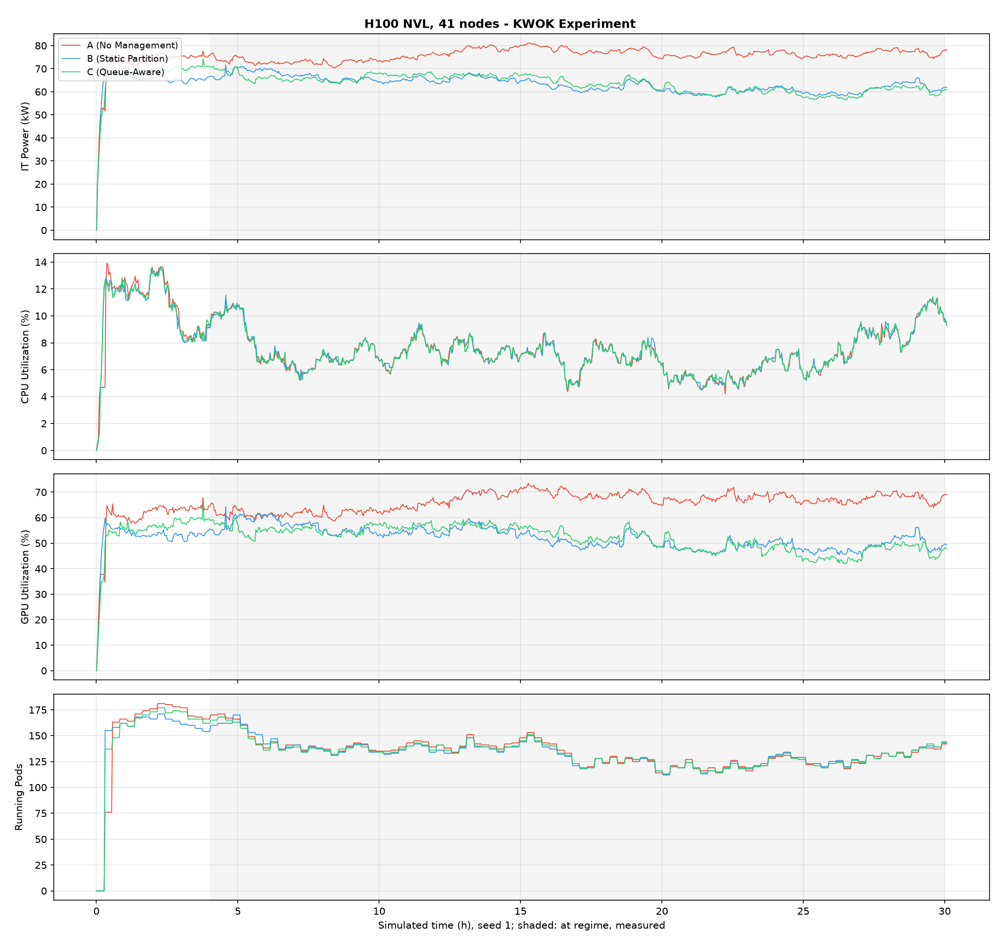
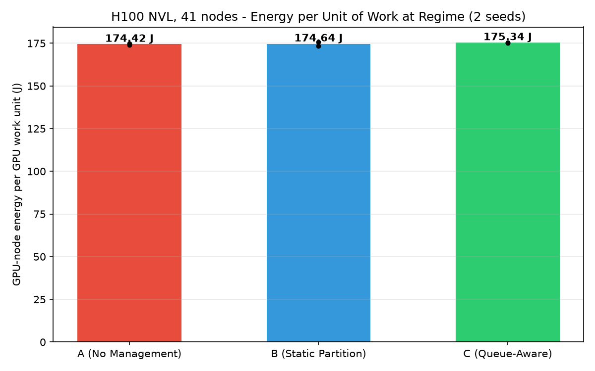
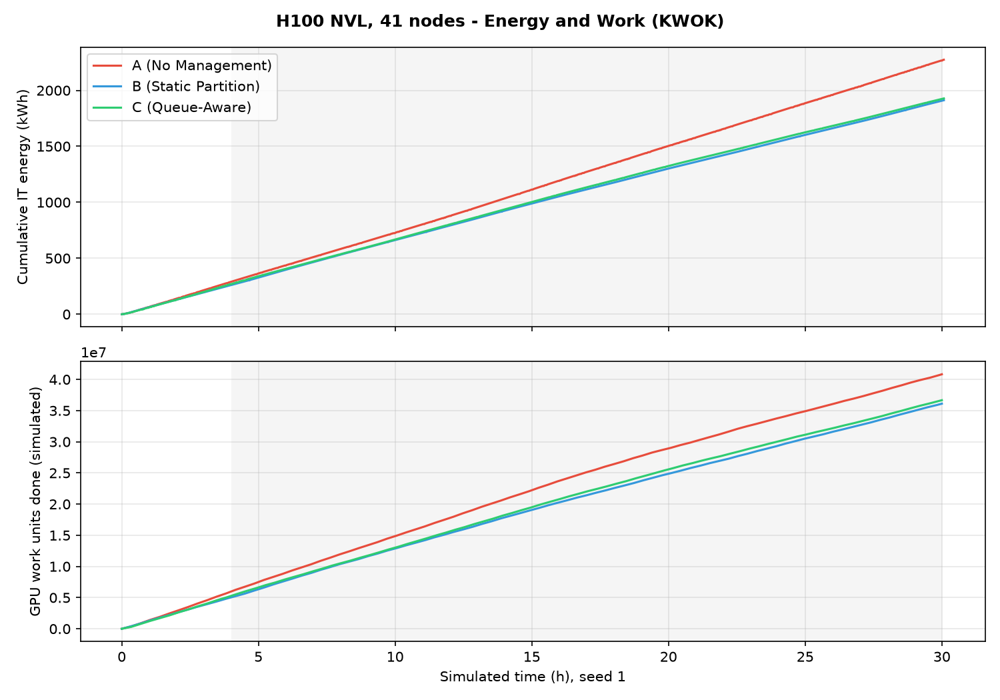
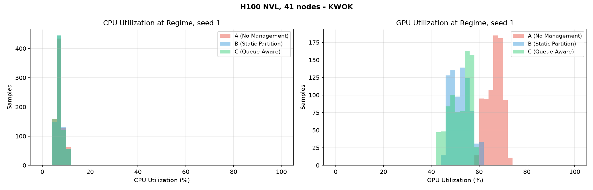
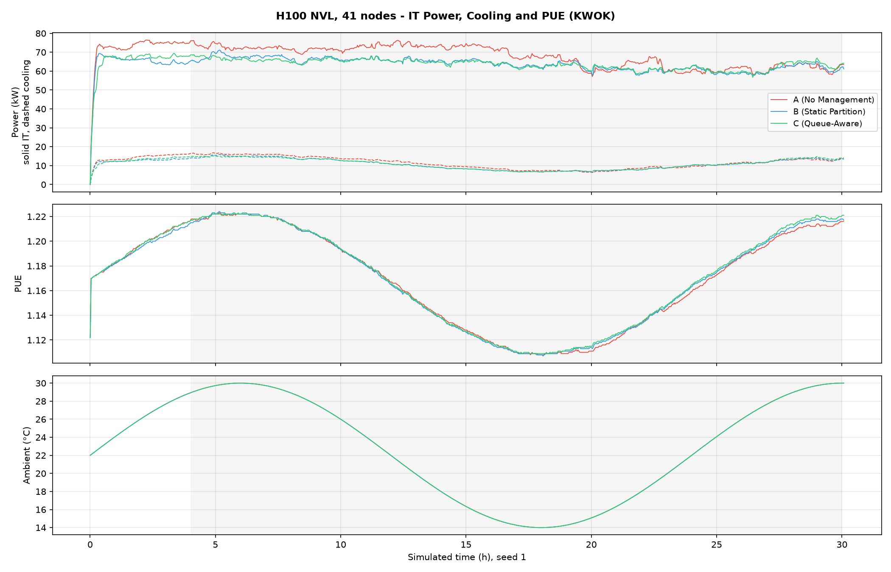
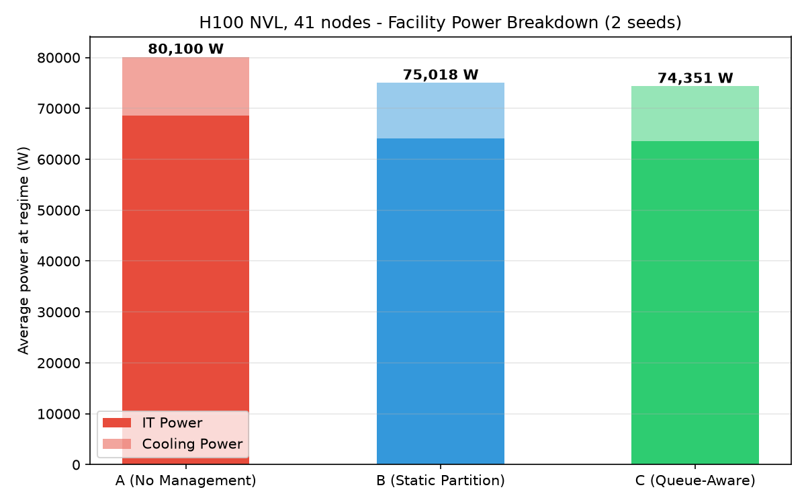

# Homogeneous H100 NVL Benchmark Report (KWOK, 41 Nodes)

These results come from the Joulie simulator, Joulie's test bed for its behaviour (caps applied, placement, policies), not evidence of energy savings. Their energy figures rest on hardware behaviour the simulator assumes: every CPU core and every GPU does the same work per second whatever its model, and cap responses, power curves and workload intensities are assumed or fitted, not measured on real nodes. They do not show what Joulie saves on real hardware; what meaningful experiments need is tracked in the milestone [Evidence-based evaluation](https://github.com/joulie-k8s/Joulie/milestone/1).

This report compares three baselines on a cluster whose GPU nodes are all H100 NVL, at regime: after the ramp-up and before the drain. The runs are of 2026-10-28, with the Joulie and simulator images `joulie.local/*:rerun-2026-10-28` built from this tree ([`experiments/README.md`](../README.md), "Images").

- `A`: the simulator only, no power management.
- `B`: Joulie with the static partition policy.
- `C`: Joulie with the queue-aware policy.

In short:
- B and C drew 5.7 to 8.8 % less IT power than A.
- They did 6.4 to 10.0 % less GPU work, and 9.2 and 9.8 performance jobs waited on average where A had 0.7.
- Per unit of GPU work, the GPU nodes' energy changed by -0.2 to +0.7 %, about nothing. A's repeat differed by 0.01 %; B's and C's own noise was not measured ([#113](https://github.com/joulie-k8s/Joulie/issues/113)).

An accounting split finds two parts that cancel:
- The H100 NVL's dynamic energy per unit fell by 1.6 to 2.6 points; its eco GPUs are capped, with a cap response fitted below 1.
- Idle power spread over less work added 2.3 to 3.5 points.

So B and C trade power for throughput at about the same energy per unit.

## 1. Experimental Setup

### 1.1 Cluster and nodes

A [kind](https://kind.sigs.k8s.io/) cluster (control plane and one worker) runs the real Kubernetes control plane and the Joulie components; 41 [KWOK](https://kwok.sigs.k8s.io/) nodes stand for the managed hardware, and the Joulie simulator models their power and runs the workload's pods.

### 1.2 Node inventory

| Nodes | Count | CPU | GPUs |
|---|---:|---|---|
| `kwok-h100-nvl` | 33 | 2 x AMD EPYC 9654 | 8 x NVIDIA H100 NVL (200 to 400 W) |
| `kwok-cpu-highcore` | 2 | 2 x AMD EPYC 9965 | none |
| `kwok-cpu-highfreq` | 2 | 2 x AMD EPYC 9375F | none |
| `kwok-cpu-intensive` | 4 | 2 x AMD EPYC 9655 | none |

264 GPUs, and 8 CPU-only nodes (`configs/cluster-nodes.yaml`).

### 1.3 Hardware models in the simulator

The H100 NVL's node class (`scripts/generate_heterogeneous_assets.py`, checked on every run by `class_failures`):
- idle 58.6 W per GPU, measured on a real node;
- `computeGamma` 0.50, the H100 PCIe's value fitted to MLPerf MaxQ against MaxP runs, since the NVL has no published data;
- `memoryEpsilon` 0.01, from published memory-bound throughput under caps.

Sources and fits: [wiki: GPU power model](https://github.com/joulie-k8s/Joulie/wiki/GPU-Power-Model#per-family-parameters). Every GPU does the same GPU work per second (`simulator/pkg/workload/rates.go`). The CPUs run as in experiment 01 (`SIM_BETA_FREQ` 1.43).

### 1.4 Run configuration

| Parameter | Value |
|---|---|
| Seeds | 2, plus a repeat of the first run (A, seed 1) |
| Time scale | 120 (one wall second is two simulated minutes) |
| Measured window | 120 to 900 wall seconds, 26 simulated hours, after a prefill of the backlog |
| Workload | 75 % GPU jobs, 25 % performance jobs, work scale 0.0646 |
| Load under A | GPU utilization 0.553 and 0.575, sized for 0.55 ([`experiments/README.md`](../README.md), "Sizing the load") |

kube-scheduler bin-packs GPUs, so whole nodes stay free for 8-GPU jobs.

### 1.5 Caps

- **GPUs.** Eco GPUs are capped at 70 % of 400 W, 280 W.
- **CPUs.** Eco GPU nodes keep their CPUs uncapped. The CPU-only nodes are capped at 60 % of sockets x TDP, as in experiment 01.

### 1.6 Policy sizing

Sized on seeds 3 and 4, which the sweep does not measure:
- **B:** keeps 27 of the 41 nodes as performance nodes (`hp_frac` 0.66).
- **C:** starts from 16 (`hp_base_frac` 0.39) and adds one per 5 performance pods, running or pending.

## 2. Policy Algorithms

- **Static partition (`static_partition`).** A fixed set of performance nodes; every other node is eco. Performance jobs may run only on performance nodes.
- **Queue-aware (`queue_aware_v1`).** The performance set follows the demand, recomputed every 300 simulated seconds.
- **Scheduler.** kube-scheduler with the Joulie scheduler extender at weight 1 under B and C. A performance job carries a required node affinity that excludes eco nodes; under A it is stripped.

## 3. Simulator Realism

- **Workload.** The trace comes from `simulator/cmd/workloadgen` (schema v2): Poisson arrivals at a rate that follows a 24-hour pattern in simulated time, with a burst hour on half of the days and a dip hour on 40 % of them. A GPU job's GPU utilization is the generator's raised by 45 % (at most 1).
- **Facility.** The outside air follows a sinusoid of 22 ± 8 °C with a period of 24 simulated hours. The PUE is an assumed analytic function of that temperature and of the IT load (`simulator/pkg/facility`); cooling power is IT power x (PUE - 1).

## 4. Measured Results

From `experiments/kwok-cluster/report_figures.py` over the runs of 2026-10-28; every run's simulator reports `BetaFreq` 1.43, and every run passed every gate.

### 4.1 Per run

| Baseline | Seed | Avg IT power (W) | GPU work (units, simulated) | GPU-node J per GPU unit | GPU util (%) | Performance nodes | Pending performance jobs | Pending 8-GPU jobs | Host load mean (28 CPUs) |
|---|---:|---:|---:|---:|---:|---:|---:|---:|---:|
| A | 1 | 67,538 | 34,816,361 | 174.9 | 55.3 | none | 0.7 | 1.0 | 3.8 |
| A | 2 | 69,508 | 35,977,891 | 173.9 | 57.5 | none | 0.7 | 0.1 | 4.1 |
| B | 1 | 63,716 | 32,569,774 | 175.8 | 52.4 | 27.0 | 8.1 | 7.1 | 3.1 |
| B | 2 | 64,545 | 33,274,192 | 173.5 | 52.4 | 27.0 | 10.2 | 9.6 | 3.8 |
| C | 1 | 63,646 | 32,590,355 | 175.5 | 52.4 | 22.5 | 6.4 | 5.8 | 4.5 |
| C | 2 | 63,422 | 32,368,823 | 175.2 | 50.7 | 25.6 | 13.3 | 12.7 | 4.5 |

### 4.2 Change against A, paired by seed

| Baseline | Avg IT power (%) | GPU work done (%) | GPU-node energy per GPU unit (%) | CPU-only-node energy per CPU-only unit (%) | Backlog at end (%) |
|---|---:|---:|---:|---:|---:|
| B | -5.7 / -7.1 | -6.5 / -7.5 | +0.5 / -0.2 | +3.8 / +7.3 | +33.9 / +27.9 |
| C | -5.8 / -8.8 | -6.4 / -10.0 | +0.3 / +0.7 | +3.1 / +6.7 | +31.5 / +38.9 |

### 4.3 Run-to-run noise

A's repeat on seed 1 (load 3.3 against 3.8) differed by +0.20 % in IT power, +0.20 % in GPU work and +0.01 % in GPU-node energy per GPU unit. B and C were not repeated, so their own noise is unknown; repeats for every arm are tracked in [#113](https://github.com/joulie-k8s/Joulie/issues/113). With changes of -0.2 to +0.7 % in energy per unit, of both signs, the energy per unit did not move measurably.

### 4.4 Where the energy went

`experiments/kwok-cluster/decompose_energy.py` splits the change in GPU-node energy per GPU unit; with one GPU family there is no placement term. It is accounting, not cause, and it is on the whole run, 0 to 900 s, so the totals differ slightly from 4.2.

| | Seed 1 B | Seed 1 C | Seed 2 B | Seed 2 C |
|---|---:|---:|---:|---:|
| Change in J per GPU unit | +0.88 % | +0.37 % | -0.16 % | +0.94 % |
| Idle (its power over less work) | +2.46 pp | +2.27 pp | +2.46 pp | +3.54 pp |
| H100 NVL dynamic energy per unit | -1.58 pp | -1.91 pp | -2.62 pp | -2.61 pp |

Under A, 30 % of the GPU nodes' energy is idle power (the GPUs' idle and the EPYC 9654 curve at 0 % load). The dynamic energy per unit falls under B and C, where the eco GPUs are capped at 280 W with a cap response fitted below 1. The jobs that run in the window also change, since performance jobs wait, and the split cannot tell the two apart.

## 5. Plot Commentary

Plots are in [`img/kwok/`](./img/kwok/).













## 6. Interpretation

On one GPU family at a GPU utilization of 0.55 to 0.58, B and C traded power for throughput. They drew 6 to 9 % less power, did 6 to 10 % less GPU work and kept 9 to 10 performance jobs waiting, at about the same GPU-node energy per unit of work. In the accounting split the dynamic energy per unit falls, where the eco GPUs are capped, and the GPU nodes' idle power, spread over less work, takes that back. B and C differ little here.

On the 8 CPU-only nodes energy per unit rose by 3 to 7 %, as in experiment 01.

## 7. Limitations

- **Cap response.** The H100 NVL's cap response is the H100 PCIe's, since no NVL data is published. Measuring caps on real nodes is tracked in [#106](https://github.com/joulie-k8s/Joulie/issues/106).
- **CPU-only nodes.** With one GPU family, the simulator's equal speed per GPU does not bias the comparison. The CPU-only nodes inherit experiment 01's equal speed per core, which is behind their 3 to 7 %. Per-device speed is tracked in [#107](https://github.com/joulie-k8s/Joulie/issues/107).
- **Noise.** There are two seeds and one repeat, of A only. Repeats for every arm are tracked in [#113](https://github.com/joulie-k8s/Joulie/issues/113).
- **Shared host.** Each run's load is listed. The mean load ranged from 3.1 to 4.5, under the gate of 28.

## Reproduce

Build and load the images as [`experiments/README.md`](../README.md) ("Images") shows, run `scripts/20_run_benchmark.sh configs/benchmark-40n.yaml`, then:

```bash
python experiments/kwok-cluster/report_figures.py RESULTS_DIR experiments/03-homogeneous-h100-benchmark/img/kwok "H100 NVL, 41 nodes" experiments/03-homogeneous-h100-benchmark/configs/benchmark-40n.yaml
python experiments/kwok-cluster/decompose_energy.py RESULTS_DIR
```
