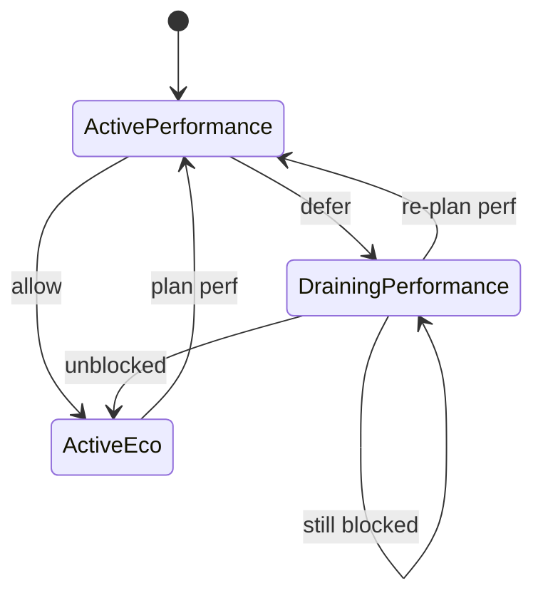

The agent is Joulie's node-side enforcement component.

It consumes desired state and applies node-local controls through configured backends.

If the controller manager decides "this node should now behave like eco" or "this node should stay performance",
the agent is the component that turns that intent into concrete control actions.

## Responsibilities

At each reconcile tick, the agent:

1. identifies its node scope (single node in daemonset mode, sharded set in pool mode),
2. discovers local CPU/GPU hardware and runtime control capability,
3. publishes `NodeHardware` for each owned node,
4. reads desired target (`NodeTwin.spec`) for each owned node,
5. resolves telemetry/control backend from environment variables (default: host),
6. applies controls (host or HTTP),
7. exports metrics and status.

## Inputs and outputs

Inputs:

- `NodeTwin.spec` for desired profile/cap
- environment variables for backend selection (`TELEMETRY_CPU_SOURCE`, `TELEMETRY_CPU_CONTROL`, etc.; default: host)
- node capability hints (for example NFD labels)

Outputs:

- `NodeHardware` for discovered hardware/capability publication
- control actions on host interfaces or simulator HTTP
- status updates (`NodeTwin.status.controlStatus`)
- Prometheus metrics (`/metrics`)

This makes the agent the node-side discovery and execution layer of the architecture: it does not plan global policy, but it does publish the hardware facts the controller manager needs to plan against.

`NodeHardware` is automatic output, not a user-authored input.
Users normally configure:

- hardware identity through node labels,
- telemetry/control backends through environment variables,
- desired targets through `NodeTwin.spec`.

## Runtime modes

- `daemonset`:
  - one pod per selected real node
  - intended for real-hardware enforcement
- `pool`:
  - one pod controls multiple logical nodes (sharded)
  - intended for KWOK/simulator scale runs

Both modes should use the same managed-node selector contract (`joulie.io/managed=true`).
In practice, pool mode enforces this through `POOL_NODE_SELECTOR`, and DaemonSet mode is restricted by default with `agent.daemonset.nodeSelector.joulie.io/managed=true`.

### K8s API client tuning

The agent and controller manager use elevated Kubernetes API client rate limits (QPS=50, Burst=100) to ensure timely reconciliation in large clusters. The default Go client limits (QPS=5, Burst=10) can cause the agent pool to process only a fraction of its managed nodes per reconcile cycle, preventing eco caps from being applied on time.

Detailed deployment/runtime configuration is documented in:

- [Agent Runtime Modes]()

## Governor discovery

At every reconcile the agent also reads the frequency governors of its node, without writing anything, and publishes them in `NodeHardware.status`. Discovery is always on; whether the agent ever writes a governor is a separate switch.

| Component | Reads (under the host `/sys` mounted at `/host-sys`) | Publishes |
|---|---|---|
| CPU | every `devices/system/cpu/cpufreq/policyN/`: `scaling_driver`, `scaling_governor`, `scaling_available_governors`, `energy_performance_preference`, `energy_performance_available_preferences`; `cpufreq/boost`, `intel_pstate/{status,no_turbo}`, `amd_pstate/status`, each policy's `boost`; the `hwp` flag of `/proc/cpuinfo` | `cpu.governor`: `driver`, `driverMode`, `current` (`mixed` when the policies differ), `available`, `epp`, `boost` (`state`, `scope`), `presets`, `baseline`, `writable` |
| CPU landmarks | `cpuinfo_min_freq`, `cpuinfo_max_freq` and `base_frequency` of every policy | `cpu.landmarks`: `minFreqMHz` (lowest minimum), `maxBoostMHz` (highest maximum), `nominalFreqMHz` (highest base frequency, intel_pstate only) |
| AMD GPU | every `bus/pci/devices/<bus id>/` with vendor `0x1002` and a `power_dpm_force_performance_level` file (and a `driver` link naming `amdgpu` where there is one): the level, the lowest and highest levels of `pp_dpm_sclk`, `pp_dpm_mclk`, `pp_dpm_fclk`, whether `pp_od_clk_voltage` exists | `gpu.governor` with `mechanism: amdgpu-sysfs`, `current` (the level, `mixed` when the GPUs differ), `uniform`, `presets`, `clockRangesMHz` (`graphics`, `memory`, `fabric`), `baseline` per bus id, `writable` |
| NVIDIA GPU | only when the `nvidia-smi` inventory query answers, as for caps: `nvidia-smi --query-gpu=pci.bus_id,clocks.sm,clocks.mem,clocks.max.sm,clocks.max.mem,pstate,clocks_throttle_reasons.active --format=csv,noheader,nounits`, asked again with `clocks_event_reasons.active` when a driver rejects that field, and `nvidia-smi -q -d SUPPORTED_CLOCKS` | `gpu.governor` with `mechanism: nvidia-smi`, `current: unknown`, `presets`, `clockRangesMHz` (`graphics`, `memory`), `baseline` per bus id |

Rules:

- GPUs are keyed by PCI bus id, never by a tool's index: `rocm-smi` and HIP enumerate GPUs in opposite orders.
- `presets` lists every preset the node accepts with the result it gives, `applied` or `equivalent`, and the native setting it maps to (`pkg/governor` is the only place that mapping lives). A preset the hardware cannot express is left out; on a node with several GPUs a preset is listed only when every GPU accepts it. The efficient GPU preset is judged at the default ceiling of 80 % of the maximum compute clock.
- The NVIDIA architecture comes from the GPU feature discovery labels `nvidia.com/gpu.compute.major` and `minor`, then the product name, then `nvidia.com/gpu.family`. A GPU older than Ampere has no mapping, so nothing is queried and no block is published.
- A clock lock cannot be read back on NVIDIA, so the baseline level is `unknown`, `current` is `unknown` until the agent sets a lock of its own (then it is the agent's record, such as `-lgc 300,1100`), and `uniform` is false. When either `nvidia-smi` query fails, `gpu.warnings` names the query that failed; the cap path is unaffected.
- The static NVIDIA facts (bus ids, supported and maximum clocks) are kept between reconciles and queried again after a failed `nvidia-smi` run, when the GPU list changes (the index, name or power limit range of a GPU), or once they are 10 minutes old.
- A GPU discovery that comes back empty keeps the last good `gpu.governor` block in `NodeHardware`, with its `mechanism`, `presets`, `current` and `baseline`, or after a restart the block `NodeHardware` stores, so the presets the controller manager plans with do not drop out for a reconcile. The governor control plans only with a discovery that answered: until one does, a GPU preset is not written (result `error`, with the warning, when a tool failed) and a restore waits.
- `presets` and `epp.available` do not depend on the governor the node runs now. amd-pstate-epp lists only `performance` in `energy_performance_available_preferences` while the governor is `performance` and its full set (`default`, `performance`, `balance_performance`, `balance_power`, `power`) under `powersave`; under `performance` discovery publishes and plans with the full set, so `balanced` and `efficiency` are `applied` there before any write and stay so after one.
- Hardware P-states (the `hwp` row of the mapping) come from the `hwp` flag of `/proc/cpuinfo`, or from an `energy_performance_preference` file under `intel_pstate` or `intel_cpufreq`, which the kernel creates only with HWP.
- `writable` comes from an `access(2)` write probe on the governor files discovery found, which writes nothing. It catches a read-only `/sys` mount and a non-root agent; a root agent passes it for every file, so an attribute the driver refuses shows only when the agent writes it. NVIDIA has no file to probe: `writable` is true while `nvidia-smi` answers.
- `baseline` is the state a restore puts back: per group of CPU policies that share a governor, preference and boost state (`policies` in the kernel's list form, such as `0-63`), and per GPU, with `recordedAt`. It follows every discovery until the agent's first governor write, so a change an operator makes before writes are on is what a restore puts back. From that write it stays fixed until a restore, also across a restart: the agent reads it back from its own `NodeHardware` and never records over it a state it may have set itself.
- A node without cpufreq, or whose policies have no `scaling_governor`, publishes no CPU governor block; one without any of the frequency files publishes no landmarks.

## Governor control

The agent sets the governor presets of its `NodeTwin`, `spec.cpu.governor` and `spec.gpu.governor`, only when `GOVERNOR_WRITES` is `true` (see [Agent governor control]()). `pkg/governor` maps each preset to the native writes of the node's driver or GPU family; the agent writes them and reports the outcome in `status.controlStatus.cpuGovernor` and `gpuGovernor`, with the native setting in `applied` (such as `powersave epp=balance_power`, `high`, `manual sclk_max=1680` or `-lgc 345,1575`).

Order in a reconcile: the CPU governor, then the CPU cap or the DVFS fallback (which writes `scaling_max_freq` and works under any governor); the GPU governor, then the GPU cap.

| Mechanism | How the agent writes | How it reads back |
|---|---|---|
| CPU (`cpufreq`) | every policy's `scaling_governor`, then `energy_performance_preference` where the row sets one (never under `performance`, which the kernel rejects), then boost when the spec names it: `cpufreq/boost`, the inverted `intel_pstate/no_turbo`, or each policy's `boost` (the global `cpufreq/boost` is turned on first when it is off) | each attribute right after its write |
| AMD GPU (`amdgpu-sysfs`) | `power_dpm_force_performance_level` of every device, by bus id, as root; `efficient` then writes `s 1 <MHz>` to `pp_od_clk_voltage`, waits until the file prints its table again, and writes `c`: the kernel takes one command per write. The devices go in lockstep, so they share each wait. | the level file; the `OD_SCLK` maximum for a ceiling |
| NVIDIA GPU (`nvidia-smi`) | `nvidia-smi -i <pci bus id> -lgc` or `-lmc`; `-rgc` and `-rmc` only for a lock in the agent's own record, so an operator's lock is never reset | none: a lock has no getter. The result is `applied-unverified` until three busy samples of the clock query (event reasons without GPU idle) show the clocks within the lock, 2 % of slack |

Outcomes:

| Result | When | Then |
|---|---|---|
| `applied`, `equivalent` | written and read back; `equivalent` when the preset has no native state of its own here (a fallback word, or the vendor default) | the next reconcile checks the setting still holds |
| `applied-unverified` | NVIDIA locks issued, not yet seen in use | turns `applied` after the busy samples |
| `unsupported` | the family cannot express the preset (nothing is written), the driver rejects the value (`EINVAL`, `EOPNOTSUPP`, `EBUSY`; amdgpu answers `EINVAL` for a level its firmware refuses, such as `high` on MI300X), the HTTP control mode or a pool agent | no retry for 30 min unless the intent changes |
| `not-applied` | the readback differs right after the write, or at the first check after it: a silent no-op, or a value an emulated driver reverts at its next tick | no retry for 30 min unless the intent changes |
| `refused` | `EACCES`, `EPERM`, `EROFS`, or an `nvidia-smi` permission error | `NodeHardware` `writable: false`; no retry until the agent restarts |
| `drift` | a checked setting changed later: another writer | applied again at most every 5 min; a level back at `auto` on AMD is a GPU reset and is applied again at once, without counting |
| `contended` | the third drift within 30 min | no more writes for that component until the intent changes |
| `disabled` | `GOVERNOR_WRITES` is `false`, or `SIMULATE_ONLY` | discovery only |
| `restored` | the field disappeared, or `GOVERNOR_WRITES` was turned off, and the baseline went back | |
| `error` | the mechanism could not run: a missing tool, a table that never printed | tried again after 5 min |

NVIDIA locks are issued again every reconcile while a locked GPU has persistence mode Disabled (a driver that unloads may forget them), and every 5 min otherwise.

Restore:

- When a field disappears (the controller manager's `GOVERNOR_CONTROL` turned off, the node left the profile that sets it, the `NodeTwin` is gone, or its spec could not be read for longer than the spec read timeout, 5 min by default, after which caps are relaxed too) the agent writes the baseline back once, only the attributes that differ from it, and only when it changed something since the baseline. A restarted agent knows that from the last result in the `NodeTwin` status. Boost goes back only when the agent wrote it, also when only the `boost` field disappears. NVIDIA restore resets the agent's own locks.
- When the agent runs with `GOVERNOR_WRITES` `false` after an earlier run changed a component, it writes the baseline back once, by the same rules, also while the field is still in the spec; that is the only write it makes, and later reconciles report `disabled`.
- On SIGTERM or SIGINT, with `GOVERNOR_RESTORE_ON_EXIT` `true` (the default), the agent stops reconciling and restores before it exits, within the pod's termination grace period. A rolling update of the agent therefore puts the baseline back and the new agent applies the preset again a reconcile later. SIGKILL and an OOM kill restore nothing; the baseline in `NodeHardware` stays for the next start. DVFS ceilings are not restored on exit.
- When there is nothing to restore, the governor status the agent wrote is removed with the field, also one an earlier run of the agent wrote.
- A restarted agent whose `NodeHardware` is gone, after an earlier run changed a component, cannot trust the state it sees: the GPU baseline is the vendor default (`auto` on AMD; an NVIDIA lock stays `unknown`), and the CPU baseline is the state seen at that start, with a warning, because the driver's default governor is unknowable.

The pod spec is unchanged: governor writes use the `/host-sys` mount, `runAsUser: 0` and the privileges the DVFS fallback already uses. An agent without them gets `refused`.

## Enforcement behavior

The agent does not choose cluster policy.
It enforces controller manager intent and reports what happened:

- `applied`
- `blocked`
- `error`

This separation keeps policy logic centralized in the controller manager and actuator logic localized in the agent.

## CPU enforcement algorithm

The agent enforces CPU power intent with this backend order:

1. Resolve desired CPU cap:
   - use `packagePowerCapWatts` when present,
   - otherwise try to resolve `packagePowerCapPctOfMax` to watts from node-local cap range.
2. If watts are available, try RAPL first (`rapl.set_power_cap_watts` via HTTP control backend, or host RAPL files).
3. If RAPL is unavailable/fails, switch to DVFS fallback controller.
4. If percentage intent cannot be resolved to watts, apply a DVFS percent fallback path (`dvfs.set_throttle_pct`) when available.
5. If RAPL becomes available again later, restore DVFS throttle and return to RAPL mode.

A cap in watts is clamped to each RAPL zone's `constraint_N_max_power_uw` before it is written: the kernel masks a larger value to the register's width, which on hardware wraps to a small cap.

Backend selection is visible in metric `joulie_backend_mode{mode=none|rapl|dvfs}`.

In short, the agent prefers direct power control when it can, and falls back to DVFS when it cannot.

### DVFS fallback control loop

When DVFS fallback is active, each reconcile tick:

1. Read observed package power (from RAPL energy deltas in host mode, or HTTP telemetry source).
2. Apply EMA smoothing:
   - `ema = alpha * observed + (1-alpha) * ema`
3. Compute hysteresis thresholds around desired cap:
   - `upper = cap + DVFS_HIGH_MARGIN_W`
   - `lower = cap - DVFS_LOW_MARGIN_W`
4. Update consecutive counters:
   - `aboveCount` if `ema > upper`
   - `belowCount` if `ema < lower`
5. Only act when counter reaches `DVFS_TRIP_COUNT`:
   - above trip -> increase throttle by `DVFS_STEP_PCT`
   - below trip -> decrease throttle by `DVFS_STEP_PCT`
6. Enforce cooldown:
   - no new action before `DVFS_COOLDOWN` since last action.

This gives both hysteresis and temporal damping, preventing oscillation.

Main tunables:

- `DVFS_EMA_ALPHA`
- `DVFS_HIGH_MARGIN_W`
- `DVFS_LOW_MARGIN_W`
- `DVFS_TRIP_COUNT`
- `DVFS_COOLDOWN`
- `DVFS_STEP_PCT`
- `DVFS_MIN_FREQ_KHZ`

### DVFS actuation details

- Host mode:
  - write cpufreq `scaling_max_freq` files.
  - a fraction of CPUs is throttled according to `throttlePct`.
- HTTP mode:
  - send `dvfs.set_throttle_pct` to simulator/backend endpoint.

Throttle state and actions are exported in:

- `joulie_dvfs_throttle_pct`
- `joulie_dvfs_above_trip_count`
- `joulie_dvfs_below_trip_count`
- `joulie_dvfs_actions_total{action=throttle_up|throttle_down}`

## GPU power cap

The agent also supports node-level GPU cap intents:

- resolves `NodeTwin.spec.gpu.powerCap`,
- computes `capWattsPerGpu` from `capPctOfMax` when needed,
- applies `gpu.set_power_cap_watts` via HTTP control backend or host backend,
- writes status in `NodeTwin.status.controlStatus.gpu` with `applied|blocked|error|none`.

Host backends are vendor-aware:

- NVIDIA path (NVIDIA tooling/NVML-compatible power limits): `nvidia-smi -pl` runs only for a GPU whose current limit, rounded to whole watts, differs from the cap. The limit comes from this reconcile's listing, so a limit the driver put back after a reset is set again. The listing, `nvidia-smi --query-gpu=index,power.min_limit,power.max_limit,power.limit,power.draw,name,power.default_limit --format=csv,noheader,nounits`, also gives the range and the default limit: `NodeHardware` publishes `power.default_limit` as `gpu.capRangePerGpu.defaultWatts`, and `maxWatts` there when the tool prints a token such as `[N/A]` or a value outside the range.
- AMD path (amdgpu sysfs, no tool): the cap range is `power1_cap_min` to `power1_cap_max` of each GPU's amdgpu hwmon device under `/host-sys/bus/pci/devices/<pci bus id>/hwmon/`, the bound the driver enforces. `power1_cap_default` is not read: the driver sets it from the cap in force whenever it initialises the GPU, so after a resume or a reset it reads the agent's own last cap, and `defaultWatts` is `maxWatts`. `power1_cap` is written in whole watts only for a GPU whose cap differs, and read back: a write the driver refuses or drops is `error` naming the bus id, while the other GPUs are still capped. A device whose `power1_cap` reads 0, the secondary die of a package such as the second GCD of an MI250X, is listed and counted, so `gpu.count` matches the allocatable `amd.com/gpu`, but never written: the driver refuses its writes with `EINVAL`, and the cap of its primary holds the whole package; `NodeHardware` then publishes `gpu.powerDomains`, the GPUs that hold a limit, and an amdgpu device without `power1_cap`, such as the integrated GPU of an APU, is not counted as a GPU. The driver refuses these reads while a GPU is runtime suspended or in reset, and sets its cap again when it resumes; the agent then uses the cap and range it last read or wrote, and a GPU it has never read gets the cap resolved from the others, the write waking it. This needs a root agent and a writable `/host-sys`, which the chart gives.

If backend support is unavailable on a node, the result is reported as `blocked`.

This keeps GPU behavior aligned with CPU behavior:

- intent is still accepted,
- enforcement is attempted through the best available backend,
- failures are reported per node instead of breaking the whole control loop.

## Performance -> eco transition and safeguards

This transition is safety-critical and is split between controller manager policy logic and agent enforcement.

### Who does what

- Controller manager:
  - decides whether a node is allowed to downgrade from performance to eco,
  - runs safeguard checks,
  - publishes desired state and scheduler-facing labels accordingly.
- Agent:
  - enforces whatever desired state is currently published for that node,
  - does not bypass safeguards on its own.

### Safeguard goal

Prevent a node from dropping to eco while it still runs workloads that require performance supply.

### Step-by-step transition flow

1. Policy plans `performance -> eco` for node `N`.
2. The controller manager evaluates safeguard on `N`:
   - classify active pods from workload-class annotations,
   - detect whether performance pods are still running on `N`.
3. If performance pods are present:
   - controller manager keeps desired profile as `eco`,
   - controller manager sets `NodeTwin.status.schedulableClass` to `draining`.
4. Agent reconciles:
   - sees desired profile from `NodeTwin.spec`,
   - enforces the desired eco/performance target through configured backend.
5. On later reconcile ticks, controller manager re-checks safeguard.
6. When no blocking performance pods remain:
   - controller manager keeps profile `eco` and sets `NodeTwin.status.schedulableClass` to `eco`.
   - agent continues enforcing desired target on next reconcile.

### Transition FSM (with conditions)

Interpretation:

- `DrainingPerformance` is the controller manager transition state.
- In `DrainingPerformance`, controller manager publishes eco as desired state, sets `NodeTwin.status.schedulableClass` to `draining`, and keeps the performance caps in the spec, so the agent does not throttle the running performance pods.
- The scheduler extender reads the `draining` schedulable class and filters the node out for performance pods, so no new performance work lands on it.
- Transition to eco occurs when safeguard condition becomes true (`performance pods == 0`).

Transition conditions:

- `defer`: policy plans eco and node still has performance pods (`count > 0`).
- `allow`: policy plans eco and node has no performance pods (`count == 0`).
- `still blocked`: periodic re-check still finds blocking pods (`count > 0`).
- `unblocked`: periodic re-check finds none (`count == 0`), so eco can be committed.
- `re-plan perf` / `plan perf`: policy decision requires performance supply.

### Why this matters

- avoids violating workload placement/intent guarantees mid-flight,
- avoids abrupt performance loss for pods that explicitly require performance nodes,
- keeps transition behavior deterministic and auditable via controller manager/agent metrics and logs.

Current behavior is defer-until-safe (no forced eviction in this path).

The practical takeaway is that the agent stays simple on purpose:
it continuously enforces the latest published target, while the controller manager owns the logic for when a target is safe to publish.

For policy-side details, see:

1. [Joulie Controller Manager]()
2. [Policy Algorithms]()

## Next steps

1. [Policy Algorithms]()
2. [Input Telemetry and Actuation Interfaces]()
